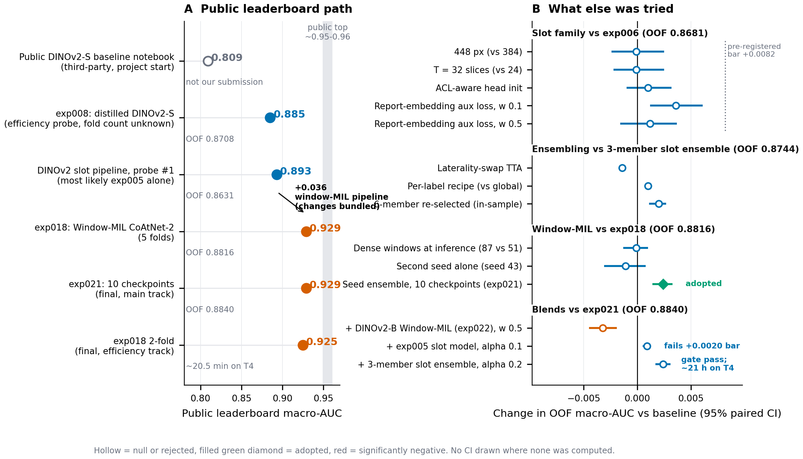
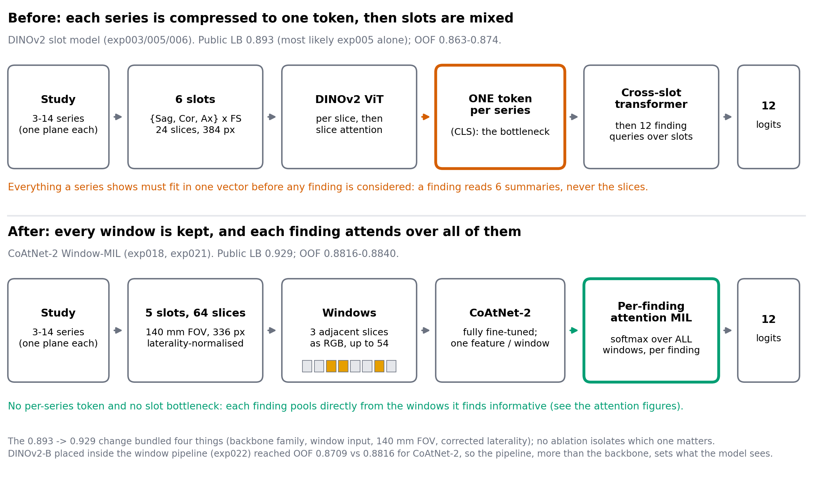

<!--
DRAFT. DO NOT POST BEFORE THE COMPETITION CLOSES (2026-10-22 23:59 UTC).
Keep the repository and every weight dataset PRIVATE until then; do not link them from anything public.
Fill every [FILL] before posting. Numbers are from docs/EXPERIMENTS.md (see docs/report/NUMBERS.md for the map).
Figures to upload with the post are in docs/figures/ (PNG). Check the competition's data terms before posting the
attention figure: it contains real training MRI slices.
-->

# From a 0.89 plateau to 0.929: weak labels, a diagnosis, and window-level attention (RSNA Knee 2026)

**TL;DR.** Only 58 of 4,407 training studies have image-review labels; the rest have reports that disagree with the
experts about 18% of the time. I built an LLM report-to-label engine calibrated on the 58, trained a DINOv2 slot model
that plateaued near 0.89 on the public leaderboard, found out why by reading what the stronger public notebooks did
differently, and moved to a CoAtNet-2 with attention over windows of adjacent slices (**0.929 public**). Final picks:
**main = 10-checkpoint ensemble of that model (public 0.929)**, **efficiency = the same model on 2 folds (public 0.925,
~20 minutes on 2 x T4)**. Final private rank: **[FILL]**. Code and weights: **[FILL: link, made public after the close]**.

## 1. The problem, and the twist

Twelve knee-MRI findings per study, scored by macro ROC-AUC. Each study is 3-14 series (sagittal / coronal / axial,
fat-suppressed or not) with 20-45 slices each. The twist is the supervision: **4,407** training studies, **58** with
the 12 image-review labels, **4,407** with a free-text radiology report (a dozen languages), and **no report at test
time**. Reports and expert labels agree only about 82% of the time, systematically: reports over-call mild disease
(meniscal degeneration, trace effusion, grade-1 chondral change), while the experts graded "on the fence" as negative.
So the quality of the labels derived from reports mattered as much as the image model.

## 2. The label engine

- Two open LLMs (Qwen2.5-72B-Instruct and Llama-3.3-70B, served with vLLM) read each report against a per-finding rubric
  that encodes the experts' severity thresholds, and return structured output per finding.
- Per label, I chose Qwen, Llama or their blend by strict leave-one-out AUC on the 58 gold studies (macro LOO 0.823).
- **One noisy-student round:** blend the report labels with an image model's own out-of-fold predictions, per-label weight
  chosen by LOO (`v3` labels). Better labels alone were worth **+0.014 OOF** at a fixed architecture. A second round (`v4`)
  regressed (-0.012 LOO), so I stopped there.
- The 58 gold studies were never trained on.

## 3. Validation (and why I did not trust the leaderboard-sized gaps)

- 5-fold GroupKFold over report-template clusters (3,681 clusters), so near-duplicate reports never straddle folds.
- Model selection used **OOF macro-AUC against the report-derived labels** (a noisy proxy), gold-58 as a tripwire only
  (n = 58 gives a 95% interval of about +/-0.03), and the public leaderboard as the external check.
- Every ablation used a **bar set in advance** (+0.0082, two bootstrap SDs of a solo model) and a paired cluster
  bootstrap over report clusters. The proxy under-rated every model on the leaderboard, by about 0.014 to 0.047 depending on the model.

## 4. First model family, and the plateau

A DINOv2 2.5D slot model: ViT per slice -> slice attention -> **one token per series** -> six slots {sagittal, coronal,
axial} x {fluid-sensitive or not} -> cross-slot transformer -> twelve per-finding queries. ViT-S -> ViT-B gave +0.005 OOF,
`v3` labels +0.014, a 3-model ensemble +0.006 (OOF 0.8744). Its public score was **0.893**.

> **A correction I owe the reader.** I described that submission as the 3-model ensemble. It almost certainly was not.
> The notebook chose its configuration from a time budget, and on Kaggle's T4s the 3 models measure ~59 s per study
> (~21 hours for the test set), so it fell back to its smallest member, a single ViT-S (exp005). I cannot confirm this
> (the hidden-test log is not visible), but the arithmetic is unambiguous. The gap between my OOF and the leaderboard for
> that model is therefore about +0.030, not the +0.019 I first recorded.

Then I tried every lever I had, each with a pre-set bar: 448 px (-0.0001), 32 slices (-0.0001), an ACL-aware head
initialisation (+0.0010), an auxiliary report-embedding loss (+0.0036 and +0.0012), a 6-member re-selected ensemble
(+0.0020, in-sample), laterality-swap TTA (-0.0014). All inside noise or below the bar. At the time I concluded the
ceiling was the labels. That was wrong.

## 5. The diagnosis

I stopped ablating my own pipeline and read the public notebooks (18 of them). Two things stood out: a public
**20-model DINOv2 ensemble also stalled at 0.891**, so the ceiling belonged to the model family, not to my labels; and one
**single CoAtNet-2 with attention over windows of adjacent slices scored 0.924**. My own audit of my cache also found a
laterality defect: sagittal right knees were mirrored front-to-back instead of medial-lateral, and 34% of studies (1,491)
had no side normalisation at all.

## 6. Window-level attention (exp018 / exp021)

- Side normalisation fixed: coronal/axial mirrored for right knees, sagittal slice order reversed, side from a validated
  table, then the DICOM tag, then an image-centre geometry rule (resolves 99.4% of the previously un-normalised studies,
  99% agreement with validated sides).
- 140 mm field of view at 336 px, 64 slices over five slots, **windows of 3 adjacent slices as RGB** (up to 54 per study).
- Fully fine-tuned CoAtNet-2; **per-finding attention over all windows**: no per-series token, no slot bottleneck.
- My labels, my folds, top-3 epoch weight averaging, and a **pre-registered kill rule** (fold-0 gold-58 < 0.880 aborts;
  fold 0 scored 0.906). Public score **0.929**. A second seed and five more folds (10 checkpoints) gained +0.0024 OOF
  (95% CI [+0.0014, +0.0033]) and the same public 0.929.

**The design follows a public notebook** ([dreaddevelopment, "Knee MRI: twelve findings from a single model"](https://www.kaggle.com/code/dreaddevelopment/knee-mri-twelve-findings-from-a-single-model));
I re-implemented it, trained on my own labels and folds, and used no third-party weights or labels. The jump from 0.893 to
0.929 bundled four changes (backbone family, window input, wider field of view, corrected laterality) and I did not
isolate them. A DINOv2-B backbone placed inside the same window pipeline scored lower (OOF 0.8709 vs 0.8816), which hints
that the pipeline matters more than the backbone, but that is a hint.

**Where it looks.** Because each finding attends over windows, the attention can be inspected. Over all 58 gold studies,
the ACL puts 62% of its attention on sagittal fat-suppressed slices (30% if uniform), Baker's cyst 45% on axial (20%).
The examples below were picked by a fixed rule before I looked at any map (most confident gold-positive study per
finding), so they are a best case, not a hit rate, and no radiologist has checked them.

## 7. Results

| | OOF | Gold-58 | Public LB | Time, 2 x T4 |
|---|---|---|---|---|
| DINOv2 slot pipeline (most likely exp005 alone) | 0.8631 | 0.8903 | 0.893 | --- |
| Window-MIL, 5 folds | 0.8816 | 0.9091 | 0.929 | ~53 min |
| **Window-MIL, 10 checkpoints (main)** | **0.8840** | **0.9111** | **0.929** | ~100 min |
| **Window-MIL, 2 folds (efficiency)** | n/a | 0.9078 | **0.925** | **~20.5 min** |

Efficiency track (assuming a best AUC of 0.95): 2 folds score -2.018 against -1.966 for 5 folds. I had projected the
5-fold run at ~15 minutes from H100 timings; measured on Kaggle's own T4s it is ~53 minutes and model-bound, so the fold
count, not decoding, is the lever. Private-leaderboard rank: **[FILL]**.

## 8. What did not work

- Higher resolution (448 px), more slices (32), anatomy-aware ACL head initialisation, an auxiliary report-text loss,
  laterality-swap TTA, a 6-member re-selected ensemble: all null against pre-set bars.
- DINOv3-S (-0.025 OOF), ConvNeXt-V2 (accurate but redundant, 0.93 correlation with the baseline), a 3D ResNet (killed).
- A second noisy-student round (regressed), EMA instead of top-3 averaging (null), dense windows at inference (null),
  a CoAtNet-3 (no pretrained checkpoint at the intended size, then a 32-bit indexing overflow in the training shape).
- **Blending the old and new models.** Two Kaggle runs wrote a valid submission and then hung at teardown until the time
  limit; a third ended in an error by design (a hard-exit test). Later, an offline blend gate passed on OOF for the
  3-model ensemble, but that ensemble cannot run in time on a T4; the single-model version fell below its bar
  (+0.0009 vs +0.0020). Closed.

## 9. Lessons

1. **A run of null ablations shows that a model family is saturated, not where the ceiling is.** Look outside your own
   pipeline before concluding "label ceiling".
2. **Measure runtime on the target hardware.** My borrowed H100-to-T4 speed factors were off by 3.6x (CoAtNet) and
   ~13x (DINOv2).
3. **A runtime fallback can silently change which model gets scored.** Log the rung that was chosen, and do not trust a
   score until you know what produced it.
4. **A reproduction proves the bug you reproduced, not the failure you saw.** I attributed a hang to a thread bug that was
   not on the failing code path, and the fix introduced a timed join that silently wrote label priors on slower GPUs. A test
   that asserts only on row counts cannot tell predictions from fallbacks.
5. Report-derived validation is a conservative proxy here (the leaderboard beat it every time), but it cannot rank models
   that differ by less than ~0.004.

## Reproducibility and credit

Code, configs and the experiment log: **[FILL: link]**. Weights: **[FILL: link]**. The pipeline uses no external medical data,
no third-party knee checkpoints and no third-party labels; only the generic ImageNet / DINOv2 initialisations from timm.
Thanks to the author of the public window-attention notebook credited above, to the competition organisers and
radiologists, and to the university HPC cluster. This is a research artifact, not a medical device.
